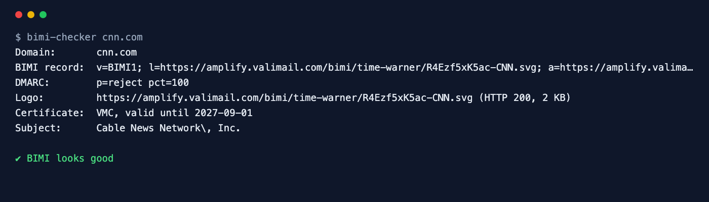

<div align="center">

# BIMI Checker

**Get your logo into the inbox: check BIMI, the SVG and the mark certificate.**

[](https://github.com/ksanyok/bimi-checker/actions/workflows/ci.yml) [](LICENSE)   [](https://promopilot.link/en/tools/bimi-checker.php?utm_source=github&utm_medium=repo&utm_campaign=tools&utm_content=bimi-checker)

**[▶ Use the free online version — no install, no sign-up](https://promopilot.link/en/tools/bimi-checker.php?utm_source=github&utm_medium=repo&utm_campaign=tools&utm_content=bimi-checker)**

</div>

`bimi-checker` verifies everything a mailbox provider looks at before it shows your brand logo next to your emails: the `default._bimi` record, the DMARC enforcement BIMI depends on, the SVG logo against the strict SVG Tiny Portable/Secure rules, and the Verified Mark Certificate or Common Mark Certificate behind `a=` — its type, owner and expiry date.



## What it checks

- A single BIMI record at `default._bimi.<domain>` (or a custom selector), with fallback to the organizational domain
- Record syntax: `v=BIMI1` first, `l=` and `a=` as single https URLs to an `.svg` and a `.pem`, explicit opt-out
- DMARC prerequisite: `p=quarantine` or `p=reject` with `pct=100` — without it no provider shows the logo
- The SVG logo against SVG Tiny PS: `version="1.2"`, `baseProfile="tiny-ps"`, a `<title>`, no `x`/`y`, no scripts, event handlers, embedded images or external links, square viewBox, under 32 KB
- The mark certificate: VMC or CMC (by the BIMI OIDs), subject, issuer, validity dates and expiry within 30 days
- The logo and certificate URLs actually return HTTP 200

## Why it matters

BIMI puts your verified logo next to your messages in Gmail, Apple Mail, Yahoo and others — a visible trust signal that measurably lifts open rates. It is also unforgiving: a logo exported from a design tool with the wrong SVG profile, a DMARC policy left at `p=none`, an expired certificate or a 404 on the logo URL, and the logo silently disappears with no error message anywhere. Running a full check after every change is the only way to know it works.

## Quick start

```bash
# run straight from GitHub, nothing to install
npx github:ksanyok/bimi-checker example.com

# or install the CLI globally
npm install -g github:ksanyok/bimi-checker
bimi-checker example.com
```

Lint your SVG before uploading it:

```bash
bimi-checker --svg logo.svg
```

Lint a record before publishing it:

```bash
bimi-checker --record "v=BIMI1; l=https://example.com/bimi/logo.svg; a=https://example.com/bimi/vmc.pem"
```

A custom selector, DNS only:

```bash
bimi-checker example.com --selector brand2 --no-fetch
```

## Example output

```text
$ bimi-checker cnn.com
Domain:       cnn.com
BIMI record:  v=BIMI1; l=https://amplify.valimail.com/bimi/time-warner/R4Ezf5xK5ac-CNN.svg; a=https://amplify.valimail.com/bimi/time-warner/R4Ezf5xK5ac-CNN.pem
DMARC:        p=reject pct=100
Logo:         https://amplify.valimail.com/bimi/time-warner/R4Ezf5xK5ac-CNN.svg (HTTP 200, 2 KB)
Certificate:  VMC, valid until 2027-09-01
Subject:      Cable News Network\, Inc.

✔ BIMI looks good
```

## CLI

```text
Usage: bimi-checker <domain> [options]
       bimi-checker --record "v=BIMI1; l=https://example.com/logo.svg; a=https://example.com/vmc.pem"
       bimi-checker --svg logo.svg

Checks the BIMI record at <selector>._bimi.<domain>, the DMARC enforcement BIMI
requires, the SVG Tiny PS logo and the Verified/Common Mark Certificate.

Options:
  --selector <s>    BIMI selector (default: "default")
  --record <bimi>   Lint a record string offline instead of querying DNS
  --svg <file>      Lint a local SVG file against the SVG Tiny PS rules
  --no-fetch        Do not download the logo and certificate
  --json            Print the full report as JSON
  --strict          Exit with code 1 on warnings too
  -h, --help        Show this help

Online version (no install): https://promopilot.link/en/tools/bimi-checker.php?utm_source=github&utm_medium=cli&utm_campaign=tools&utm_content=bimi-checker
```

## Use as a library

```js
import { checkBimi, lintSvg, inspectCertificate } from '@promopilot/bimi-checker';

const report = await checkBimi('example.com');
console.log(report.record, report.dmarc, report.certificate?.validTo);
for (const issue of report.issues) console.log(issue.level, issue.code, issue.message);

// Offline helpers
lintSvg(fs.readFileSync('logo.svg', 'utf8'));        // [{ code: 'svg-profile', ... }]
inspectCertificate(fs.readFileSync('vmc.pem', 'utf8')); // { type: 'VMC', subject, validTo, issues }
```

`checkBimi(domain, { selector, resolveTxt, fetch, fetchAssets })` returns `{ domain, selector, record, recordName, tags, dmarc, logo, certificate, issues[], ok }`. Inject `fetch` and `resolveTxt` for tests or proxies. Issue codes are stable (`no-bimi`, `dmarc-not-enforced`, `svg-profile`, `svg-title`, `cert-expired`, `cert-not-mark`, `no-certificate`, …).

## Use in CI (GitHub Actions)

Catch an expiring certificate or a broken logo URL before your logo disappears from inboxes:

```yaml
on:
  schedule: [{ cron: '0 6 * * *' }]
jobs:
  check:
    runs-on: ubuntu-latest
    steps:
      - uses: ksanyok/bimi-checker@v1
        with:
          args: example.com --strict
```

## How it works

TXT records are read with Node's built-in resolver from `<selector>._bimi.<domain>` and, for subdomains, the organizational domain. The DMARC record is read the same way and its `p` and `pct` checked. The logo is downloaded with the built-in `fetch` and linted with a static rule set derived from the BIMI SVG Tiny PS profile (it is not a full RelaxNG validation, but catches what real-world logos get wrong). The certificate is parsed with `crypto.X509Certificate`; the mark type is detected by the BIMI policy OIDs embedded in the certificate (`1.3.6.1.4.1.53087.1.1` for VMC, `.4.1` for CMC).

## CLI vs. online version

| | This package | [Online tool](https://promopilot.link/en/tools/bimi-checker.php?utm_source=github&utm_medium=repo&utm_campaign=tools&utm_content=bimi-checker) |
|---|---|---|
| Runs on | Your machine, CI, cron | Any browser |
| Local SVG linting | Yes, `--svg` | Upload not needed — checks the published logo |
| Output | Text, JSON, exit codes | Logo preview and visual report |
| Extras | Custom resolver and fetch | MTA-STS, SPF, DKIM and DMARC on one site |
| Price | Free, MIT | Free, no sign-up |


## FAQ

<details>
<summary><b>Do I need a VMC to use BIMI?</b></summary>

Yahoo and some others show a logo from a self-asserted record without a certificate. Gmail and Apple Mail require a Verified Mark Certificate (registered trademark) or a Common Mark Certificate. Without `a=` this tool shows a warning, not an error.
</details>

<details>
<summary><b>Why does my exported SVG fail?</b></summary>

Design tools export SVG 1.1 with `x`/`y` on the root, no `<title>` and sometimes embedded bitmaps. BIMI needs SVG Tiny PS: set `version="1.2"` and `baseProfile="tiny-ps"`, add `<title>Brand name</title>`, remove `x`/`y`, scripts and external links, and make it square.
</details>

<details>
<summary><b>Is p=none enough for BIMI?</b></summary>

No. BIMI only works with DMARC enforcement: `p=quarantine` or `p=reject`, applied to 100% of mail (`pct=100` or no pct at all).
</details>

<details>
<summary><b>Where do I host the logo and certificate?</b></summary>

Anywhere over HTTPS with a valid certificate — your own site or a CDN. Many certificate authorities host them for you.
</details>

<details>
<summary><b>I set everything up but Gmail still shows no logo</b></summary>

Gmail caches and also uses sender reputation; logos can take days to appear and need consistent DMARC-passing volume. If this tool reports no errors, the setup itself is correct.
</details>

<details>
<summary><b>Is there a version without installing anything?</b></summary>

Yes — the [online BIMI Checker](https://promopilot.link/en/tools/bimi-checker.php?utm_source=github&utm_medium=repo&utm_campaign=tools&utm_content=bimi-checker) runs the same checks in the browser and explains each result.
</details>

## Related free tools

- [DMARC Checker](https://promopilot.link/en/tools/dmarc-checker.php?utm_source=github&utm_medium=repo&utm_campaign=tools&utm_content=dmarc-checker) — policy, alignment and report addresses
- [SPF Checker](https://promopilot.link/en/tools/spf-checker.php?utm_source=github&utm_medium=repo&utm_campaign=tools&utm_content=spf-checker) — validate SPF and the 10-lookup limit
- [DKIM Checker](https://promopilot.link/en/tools/dkim-checker.php?utm_source=github&utm_medium=repo&utm_campaign=tools&utm_content=dkim-checker) — find selectors and validate DKIM keys
- [MX Lookup](https://promopilot.link/en/tools/mx-lookup.php?utm_source=github&utm_medium=repo&utm_campaign=tools&utm_content=mx-lookup) — mail servers, priorities and provider detection
- [Favicon Checker](https://promopilot.link/en/tools/favicon-checker.php?utm_source=github&utm_medium=repo&utm_campaign=tools&utm_content=favicon-checker) — every icon, manifest and size a browser looks for
- [All 120+ free SEO, email and web tools](https://promopilot.link/en/tools/?utm_source=github&utm_medium=repo&utm_campaign=tools&utm_content=bimi-checker)

## Contributing

Bug reports and pull requests are welcome — see [CONTRIBUTING.md](CONTRIBUTING.md). Security issues: [SECURITY.md](SECURITY.md).
More docs live in the [wiki](https://github.com/ksanyok/bimi-checker/wiki) (sources in [docs/wiki](docs/wiki)).

## License

[MIT](LICENSE) © 2026 Alexandr Krikun

---

<sub>Built and maintained by the team behind [PromoPilot](https://promopilot.link/?utm_source=github&utm_medium=repo&utm_campaign=tools&utm_content=bimi-checker) — link building, SEO monitoring and 120+ free tools for site owners. Also on [YouTube](https://www.youtube.com/channel/UCPB8m7BgaexcZh0Vr49ViYA).</sub>
